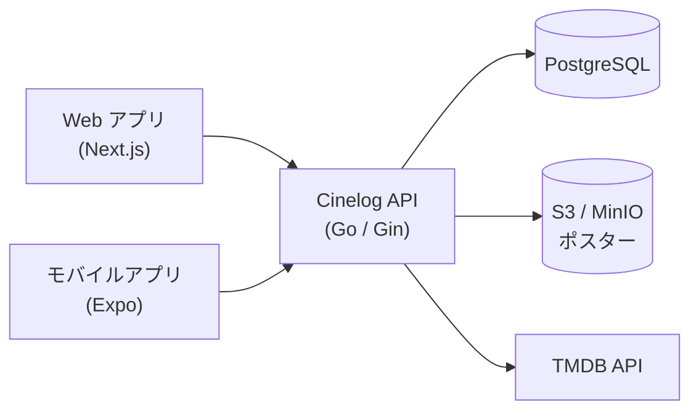
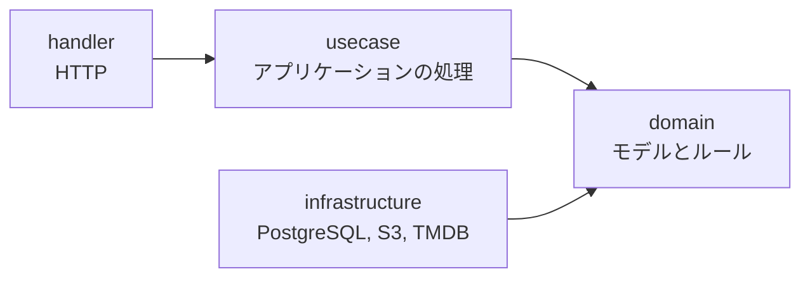
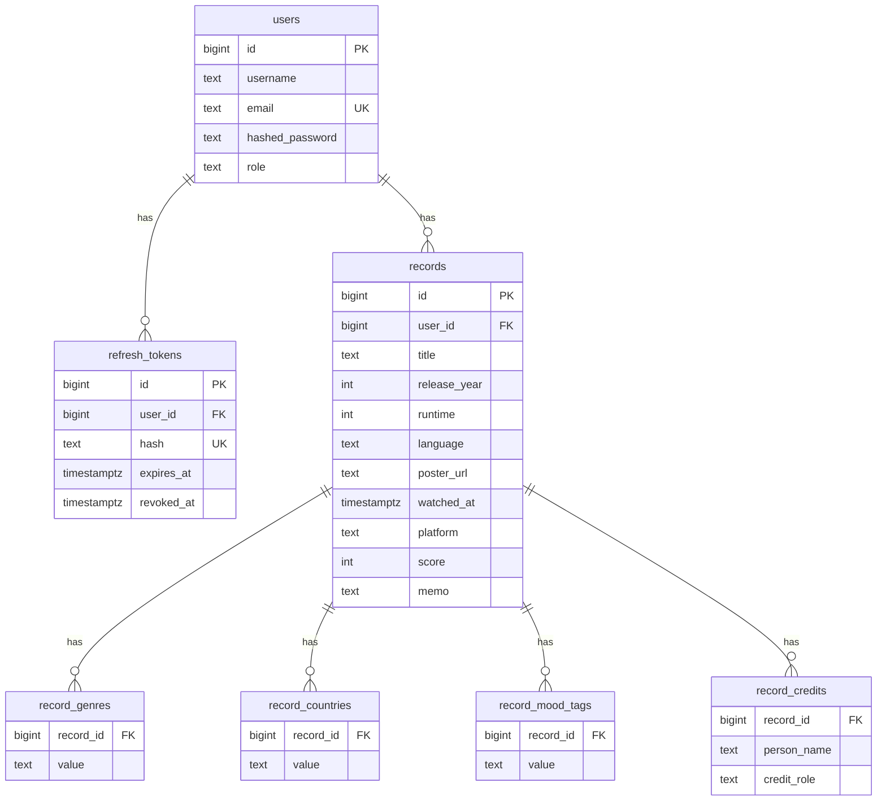

<div align="center">

# Cinelog API

[English](README.md) | **日本語**

観た映画を記録するアプリ Cinelog の REST API です。記録を保存し、TMDB で映画を調べ、ポスター画像を保管します。


</div>

このリポジトリはバックエンドです。[Web アプリ](https://github.com/masaya-nishimura-09/movie-log)と[モバイルアプリ](https://github.com/masaya-nishimura-09/movie-log-mobile)から使われます。

## 構成



コードはドメイン駆動設計とクリーンアーキテクチャで組んでいます。依存はすべて内側の domain に向かいます。infrastructure 層は、domain が定義したインターフェースを実装します。



## 機能

**記録**

- 観た映画の記録を作成、表示、編集、削除する
- タイトルで検索し、スコア、プラットフォーム、気分、ジャンルで絞り込み、並べ替えとページ送りをする
- 記録ごとにジャンル、制作国、クレジット、気分、メモを残す

**映画**

- TMDB でタイトルから映画を検索し、指定した言語で詳細を取得する

**メディア**

- ポスター画像（JPEG、PNG、WebP、5 MB まで）を S3 互換ストレージにアップロードする
- アカウントを削除すると、そのユーザーのポスターも削除する

**アカウント**

- 登録、ログイン、ログアウト
- 有効期限の短い JWT アクセストークンと、更新のたびに入れ替わるリフレッシュトークン
- リフレッシュトークンは SHA-256、パスワードは bcrypt でハッシュ化して保存する

**保護**

- ログイン、登録、トークン更新はクライアントの IP ごと、映画の検索と取得、アップロードはユーザーごとに回数を制限する
- JSON のリクエストボディは 1 MB まで
- クライアントの IP は、信頼済みのプロキシか、共有の内部シークレットを送ってきた Web アプリからだけ受け取る

## 技術スタック

| 分野           | ツール                                  |
|----------------|-----------------------------------------|
| 言語           | Go                                      |
| フレームワーク | Gin                                     |
| データベース   | PostgreSQL、GORM                        |
| ストレージ     | Amazon S3 / MinIO（AWS SDK for Go v2）  |
| 認証           | golang-jwt、bcrypt                      |
| その他         | ulule/limiter、godotenv、Docker Compose |

## はじめかた

### 必要なもの

- Go 1.26 以上
- Docker と Docker Compose
- [TMDB](https://www.themoviedb.org/) の API 読み取りアクセストークン

### インストール

```bash
git clone https://github.com/masaya-nishimura-09/movie-log-api.git
cd movie-log-api
cp .env.example .env
# .env を編集して設定する
docker compose up -d postgres minio createbuckets
go run ./cmd/movie-log-api
```

API は `http://localhost:8080` で起動します。初回の起動時に、`scripts/create_tables.sql` でテーブルが作られ、`scripts/seed.sql` でデータが入ります。

### シードユーザー

| メールアドレス      | パスワード  |
|---------------------|-------------|
| `test@example.com`  | `Password1` |
| `test2@example.com` | `Password1` |

### 設定

`.env` に次の値を設定します。

| 変数                      | 必須   | 説明                                                                 |
|---------------------------|--------|----------------------------------------------------------------------|
| `GIN_MODE`                | いいえ | `debug`、`release`、`test` のいずれか                                |
| `POSTGRES_DSN`            | はい   | API が使う PostgreSQL の接続文字列                                   |
| `POSTGRES_*`              | はい   | Docker Compose が使うデータベースの設定                              |
| `JWT_SECRET`              | はい   | アクセストークンの署名に使う秘密鍵（32 バイト以上）                  |
| `ACCESS_TOKEN_TTL_HOURS`  | いいえ | アクセストークンの有効期限（時間、初期値 `1`）                       |
| `REFRESH_TOKEN_TTL_HOURS` | いいえ | リフレッシュトークンの有効期限（時間、初期値 `720`）                 |
| `AWS_REGION`              | はい   | ストレージのリージョン                                               |
| `AWS_ACCESS_KEY_ID`       | はい   | ストレージのアクセスキー                                             |
| `AWS_SECRET_ACCESS_KEY`   | はい   | ストレージのシークレットキー                                         |
| `S3_ENDPOINT`             | いいえ | MinIO など S3 互換ストレージのエンドポイント                         |
| `S3_BUCKET`               | はい   | ポスターを保存するバケット                                           |
| `S3_PUBLIC_BASE_URL`      | はい   | ポスターを公開する URL の先頭部分                                    |
| `TMDB_ACCESS_TOKEN`       | はい   | TMDB API の読み取りアクセストークン                                  |
| `TMDB_ENDPOINT`           | はい   | TMDB API のベース URL                                                |
| `TMDB_POSTER_BASE_URL`    | はい   | TMDB のポスター画像のベース URL                                      |
| `TRUSTED_PROXIES`         | いいえ | クライアントの IP を信用するプロキシの IP または CIDR（カンマ区切り） |
| `INTERNAL_API_SECRET`     | いいえ | Web アプリと共有する秘密値。一致すると、Web アプリが送る `X-Real-IP` で回数を制限する（Web アプリと同じ値） |

## テスト

```bash
docker compose up -d postgres-test minio-test createbuckets
go test ./...
```

テストは `.env.test` を読み込み、テスト用のコンテナ（PostgreSQL はポート 5433、MinIO はポート 9002）を使います。

## ディレクトリ構成

```
cmd/movie-log-api/    # エントリーポイントと依存の組み立て
internal/
  domain/             # モデル、値オブジェクト、リポジトリのインターフェース
  usecase/            # アプリケーションの処理
  handler/            # HTTP ハンドラーとエラーレスポンス
  infrastructure/     # PostgreSQL、S3、TMDB の実装
  middleware/         # JWT 認証、ボディサイズの制限、回数制限のキー
  config/             # 環境変数
  testutil/           # テスト用コンテナを使うテストのヘルパー
scripts/              # テーブル定義とシードデータ
```

## API

「認証」が「はい」のエンドポイントには、アクセストークンを `Authorization: Bearer <token>` で送ります。エラーはすべて同じ形で返ります。

```json
{ "code": "INVALID_INPUT", "message": "per page must be between 1 and 100" }
```

### 認証

| メソッド | エンドポイント | 説明                                         | 回数制限 |
|----------|----------------|----------------------------------------------|----------|
| POST     | /auth/login    | ログインして両方のトークンを受け取る         | 5 回/分  |
| POST     | /auth/logout   | リフレッシュトークンを無効にする             |          |
| POST     | /auth/refresh  | リフレッシュトークンを新しいトークンに交換する | 30 回/分 |

### ユーザー

| メソッド | エンドポイント  | 説明                   | 認証   | 回数制限    |
|----------|-----------------|------------------------|--------|-------------|
| POST     | /users/register | 登録                   | いいえ | 10 回/時間  |
| GET      | /users/         | ログイン中のユーザーを取得 | はい |             |
| PUT      | /users/         | ログイン中のユーザーを更新 | はい |             |
| DELETE   | /users/         | ログイン中のユーザーを削除 | はい |             |

### 記録

| メソッド | エンドポイント | 説明             | 認証 |
|----------|----------------|------------------|------|
| POST     | /records/      | 記録を作成       | はい |
| GET      | /records/      | 自分の記録の一覧 | はい |
| GET      | /records/:id   | 記録を取得       | はい |
| PUT      | /records/:id   | 記録を更新       | はい |
| DELETE   | /records/:id   | 記録を削除       | はい |

`GET /records/` では次のクエリパラメータを使えます。すべて省略できます。

| パラメータ   | 説明                                                   | 初期値       |
|--------------|--------------------------------------------------------|--------------|
| `title`      | タイトルの一部                                         |              |
| `score`      | スコア（1〜5）                                         |              |
| `platform`   | プラットフォーム（`netflix`、`theater` など）          |              |
| `mood_tags`  | 気分。複数指定でき、すべてを持つ記録だけを返す         |              |
| `genres`     | ジャンル。複数指定でき、すべてを持つ記録だけを返す     |              |
| `sort_field` | `watched_at`、`release_year`、`score`、`title` のいずれか | `watched_at` |
| `sort_order` | `asc` または `desc`                                    | `desc`       |
| `page`       | ページ番号                                             | `1`          |
| `per_page`   | 1ページの件数（1〜100）                                | `20`         |

### 映画

| メソッド | エンドポイント | 説明                         | 認証 | 回数制限               |
|----------|----------------|------------------------------|------|------------------------|
| GET      | /movies/search | TMDB でタイトルから検索      | はい | 60 回/分（ユーザーごと） |
| GET      | /movies/:id    | TMDB から映画の詳細を取得    | はい | 60 回/分（ユーザーごと） |

どちらも `language`（初期値 `en`）を指定できます。検索ではさらに `title` と `page` を指定します。回数は2つのエンドポイントで合計して数えます。

### メディア

| メソッド | エンドポイント | 説明                     | 認証 | 回数制限               |
|----------|----------------|--------------------------|------|------------------------|
| POST     | /media/        | ポスターをアップロード   | はい | 30 回/時間（ユーザーごと） |

## データモデル



## ロードマップ

- 検索に Elasticsearch を使う
- 今日観る映画をおすすめする
- 他の人に映画をおすすめする
- 観た映画を振り返る
- 古い映画に対応する
- 自由入力の気分タグを LLM で変換する

## クレジット

このアプリケーションは TMDB と TMDB の API を使用していますが、TMDB による承認、認定、その他の許可を受けたものではありません。
