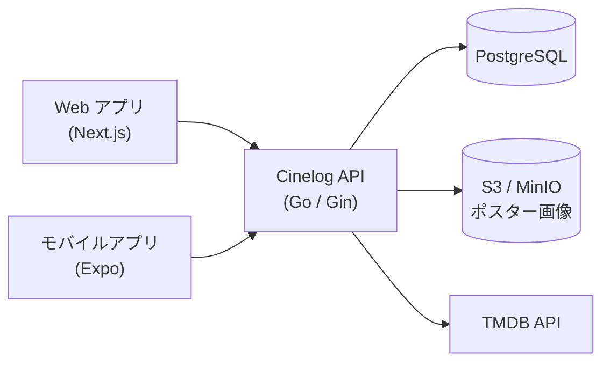
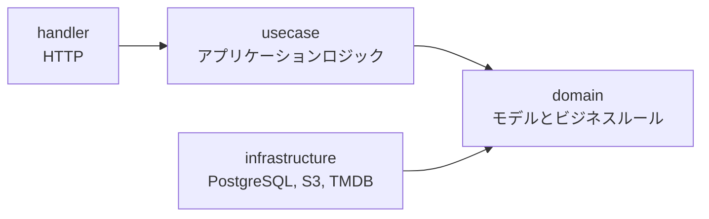
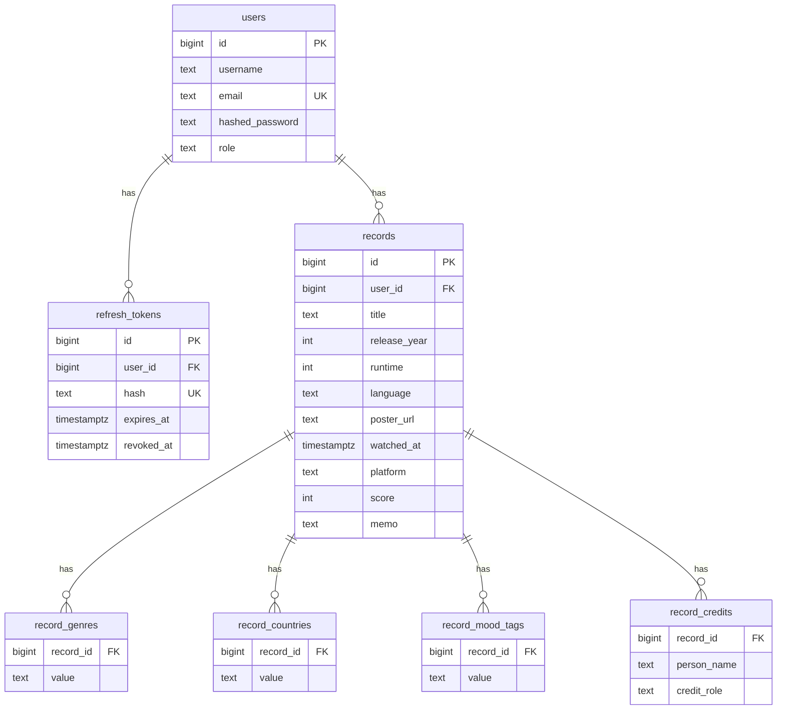

<div align="center">

# Cinelog API

[English](README.md) | **日本語**

映画鑑賞記録アプリ「Cinelog」のバックエンドを担う REST API です。<br/>鑑賞記録の管理、TMDB を利用した映画情報の検索、ポスター画像の保存を提供します。


</div>

本リポジトリでは、[Web アプリ](https://github.com/masaya-nishimura-09/movie-log)および[モバイルアプリ](https://github.com/masaya-nishimura-09/movie-log-mobile)が利用する API サーバーを管理しています。

## アーキテクチャ

### システム構成



### レイヤー構成

ドメイン駆動設計（DDD）とクリーンアーキテクチャに基づいて設計しています。各層の依存は常に内側の domain 層へ向かい、infrastructure 層は domain 層で定義されたインターフェースを実装します。



## 主な機能

**鑑賞記録**

- 鑑賞記録の作成・取得・更新・削除
- タイトル検索、スコア・プラットフォーム・気分・ジャンルによる絞り込み、並べ替え、ページネーション
- ジャンル、制作国、クレジット、気分、メモの記録

**映画情報**

- TMDB を利用したタイトル検索と、指定した言語での詳細情報の取得

**メディア**

- S3 互換ストレージへのポスター画像のアップロード（JPEG・PNG・WebP、最大 5 MB）
- アカウント削除時における、該当ユーザーのポスター画像の削除

**アカウント**

- ユーザー登録、ログイン、ログアウト
- 有効期間の短い JWT アクセストークンと、更新のたびにローテーションされるリフレッシュトークンによる認証
- リフレッシュトークンは SHA-256、パスワードは bcrypt でハッシュ化して保存

**セキュリティ**

- レート制限（ログイン・ユーザー登録・トークン更新はクライアント IP 単位、映画情報の取得とポスター画像のアップロードはユーザー単位）
- JSON リクエストボディのサイズ制限（最大 1 MB）
- クライアント IP の取得元を、信頼済みプロキシと内部シークレットで認証された Web アプリに限定

## 技術スタック

| 分類           | 使用技術                                |
|----------------|-----------------------------------------|
| 言語           | Go                                      |
| フレームワーク | Gin                                     |
| データベース   | PostgreSQL、GORM                        |
| ストレージ     | Amazon S3 / MinIO（AWS SDK for Go v2）  |
| 認証           | golang-jwt、bcrypt                      |
| その他         | ulule/limiter、godotenv、Docker Compose |

## セットアップ

### 前提条件

- Go 1.26 以上
- Docker および Docker Compose
- [TMDB](https://www.themoviedb.org/) API の読み取りアクセストークン

### インストール

```bash
git clone https://github.com/masaya-nishimura-09/movie-log-api.git
cd movie-log-api
cp .env.example .env
# .env を編集し、各環境変数を設定する
docker compose up -d postgres minio createbuckets
go run ./cmd/movie-log-api
```

API は `http://localhost:8080` で起動します。データベースの初回起動時に、`scripts/create_tables.sql` によってテーブルが作成され、`scripts/seed.sql` によって初期データが投入されます。

### 初期ユーザー

初期データには、次のテスト用ユーザーが含まれています。

| メールアドレス      | パスワード  |
|---------------------|-------------|
| `test@example.com`  | `Password1` |
| `test2@example.com` | `Password1` |

### 環境変数

`.env` に次の環境変数を設定してください。

| 変数                      | 必須/任意 | 説明                                                                 |
|---------------------------|-----------|----------------------------------------------------------------------|
| `GIN_MODE`                | 任意      | Gin の動作モード（`debug`、`release`、`test`）                       |
| `POSTGRES_DSN`            | 必須      | API が使用する PostgreSQL の接続文字列                               |
| `POSTGRES_*`              | 必須      | Docker Compose が使用するデータベースの設定                          |
| `JWT_SECRET`              | 必須      | アクセストークンの署名鍵（32 バイト以上）                            |
| `ACCESS_TOKEN_TTL_HOURS`  | 任意      | アクセストークンの有効期間（時間単位、既定値 `1`）                   |
| `REFRESH_TOKEN_TTL_HOURS` | 任意      | リフレッシュトークンの有効期間（時間単位、既定値 `720`）             |
| `AWS_REGION`              | 必須      | ストレージのリージョン                                               |
| `AWS_ACCESS_KEY_ID`       | 必須      | ストレージのアクセスキー ID                                          |
| `AWS_SECRET_ACCESS_KEY`   | 必須      | ストレージのシークレットアクセスキー                                 |
| `S3_ENDPOINT`             | 任意      | S3 互換ストレージ（MinIO など）のエンドポイント                      |
| `S3_BUCKET`               | 必須      | ポスター画像を保存するバケット名                                     |
| `S3_PUBLIC_BASE_URL`      | 必須      | ポスター画像を公開するベース URL                                     |
| `TMDB_ACCESS_TOKEN`       | 必須      | TMDB API の読み取りアクセストークン                                  |
| `TMDB_ENDPOINT`           | 必須      | TMDB API のベース URL                                                |
| `TMDB_POSTER_BASE_URL`    | 必須      | TMDB のポスター画像のベース URL                                      |
| `TRUSTED_PROXIES`         | 任意      | 信頼するプロキシの IP アドレスまたは CIDR（カンマ区切り）            |
| `APP_VERSION`             | 任意      | ログに記録するバージョン（Git のコミット ID など）                   |
| `INTERNAL_API_SECRET`     | 任意      | Web アプリとの共有シークレット。一致した場合、Web アプリから送られる `X-Real-IP` をレート制限に使用（Web アプリと同じ値を設定） |

## テスト

```bash
docker compose up -d postgres-test minio-test createbuckets
go test ./...
```

テストは `.env.test` を読み込み、テスト用コンテナ（PostgreSQL：ポート 5433、MinIO：ポート 9002）に接続して実行されます。

## ディレクトリ構成

```
cmd/movie-log-api/    # エントリーポイント、依存関係の組み立て
internal/
  domain/             # モデル、値オブジェクト、リポジトリのインターフェース
  usecase/            # アプリケーションロジック
  handler/            # HTTP ハンドラー、エラーレスポンス
  infrastructure/     # PostgreSQL・S3・TMDB との連携の実装
  middleware/         # JWT 認証、リクエストボディのサイズ制限、レート制限のキー生成
  logging/            # エラー・警告の構造化ログ（JSON）
  config/             # 環境変数の読み込み
  testutil/           # テスト用コンテナを利用するテストのヘルパー
scripts/              # テーブル定義、初期データ
```

## API

認証が必要なエンドポイントでは、`Authorization: Bearer <token>` ヘッダーにアクセストークンを指定してください。エラーレスポンスは、すべて次の形式で返されます。

```json
{ "code": "INVALID_INPUT", "message": "per page must be between 1 and 100" }
```

### 認証

| メソッド | エンドポイント | 説明                                               | レート制限 |
|----------|----------------|----------------------------------------------------|------------|
| POST     | /auth/login    | ログイン（アクセストークンとリフレッシュトークンを発行） | 5 回/分    |
| POST     | /auth/logout   | ログアウト（リフレッシュトークンを無効化）         |            |
| POST     | /auth/refresh  | リフレッシュトークンによるトークンの再発行         | 30 回/分   |

### ユーザー

| メソッド | エンドポイント  | 説明                         | 認証 | レート制限  |
|----------|-----------------|------------------------------|------|-------------|
| POST     | /users/register | ユーザー登録                 | 不要 | 10 回/時間  |
| GET      | /users/         | ログイン中のユーザー情報の取得 | 必要 |             |
| PUT      | /users/         | ログイン中のユーザー情報の更新 | 必要 |             |
| DELETE   | /users/         | ログイン中のユーザーの削除   | 必要 |             |

### 鑑賞記録

| メソッド | エンドポイント | 説明                 | 認証 |
|----------|----------------|----------------------|------|
| POST     | /records/      | 鑑賞記録の作成       | 必要 |
| GET      | /records/      | 鑑賞記録の一覧取得   | 必要 |
| GET      | /records/:id   | 鑑賞記録の取得       | 必要 |
| PUT      | /records/:id   | 鑑賞記録の更新       | 必要 |
| DELETE   | /records/:id   | 鑑賞記録の削除       | 必要 |

`GET /records/` では、次のクエリパラメータを指定できます（いずれも任意）。

| パラメータ   | 説明                                                         | 既定値       |
|--------------|--------------------------------------------------------------|--------------|
| `title`      | タイトル（部分一致）                                         |              |
| `score`      | スコア（1〜5）                                               |              |
| `platform`   | プラットフォーム（`netflix`、`theater` など）                |              |
| `mood_tags`  | 気分（複数指定可。指定したすべての気分を含む記録のみを返す） |              |
| `genres`     | ジャンル（複数指定可。指定したすべてのジャンルを含む記録のみを返す） |  |
| `sort_field` | 並べ替えの基準（`watched_at`、`release_year`、`score`、`title`） | `watched_at` |
| `sort_order` | 並び順（`asc`、`desc`）                                      | `desc`       |
| `page`       | ページ番号                                                   | `1`          |
| `per_page`   | 1 ページあたりの件数（1〜100）                               | `20`         |

### 映画情報

| メソッド | エンドポイント | 説明                       | 認証 | レート制限                 |
|----------|----------------|----------------------------|------|----------------------------|
| GET      | /movies/search | TMDB での映画の検索        | 必要 | 60 回/分（ユーザー単位）   |
| GET      | /movies/:id    | TMDB からの映画詳細の取得  | 必要 | 60 回/分（ユーザー単位）   |

いずれのエンドポイントでも `language`（既定値 `en`）を指定できます。検索時には、あわせて `title` と `page` を指定します。レート制限の回数は、2 つのエンドポイントの合計で計算されます。

### メディア

| メソッド | エンドポイント | 説明                       | 認証 | レート制限                 |
|----------|----------------|----------------------------|------|----------------------------|
| POST     | /media/        | ポスター画像のアップロード | 必要 | 30 回/時間（ユーザー単位） |

## データモデル



## ロードマップ

- Elasticsearch による検索機能の強化
- その日に観る映画のレコメンド
- 他のユーザーへの映画のおすすめ
- 鑑賞履歴の振り返り
- 旧作映画への対応
- LLM による自由入力の気分タグの変換

## クレジット

本アプリケーションは TMDB および TMDB API を使用していますが、TMDB による推奨、認定、その他の承認を受けたものではありません。
