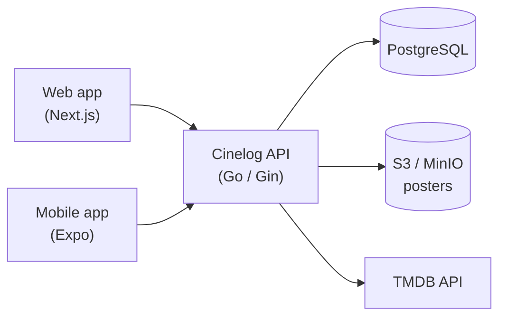
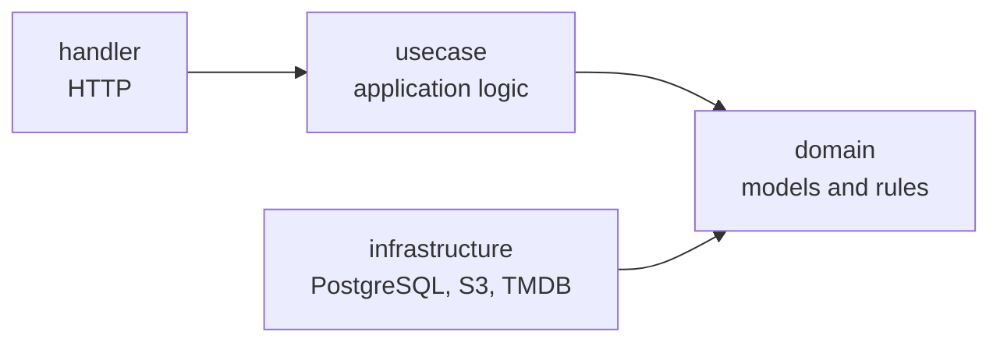
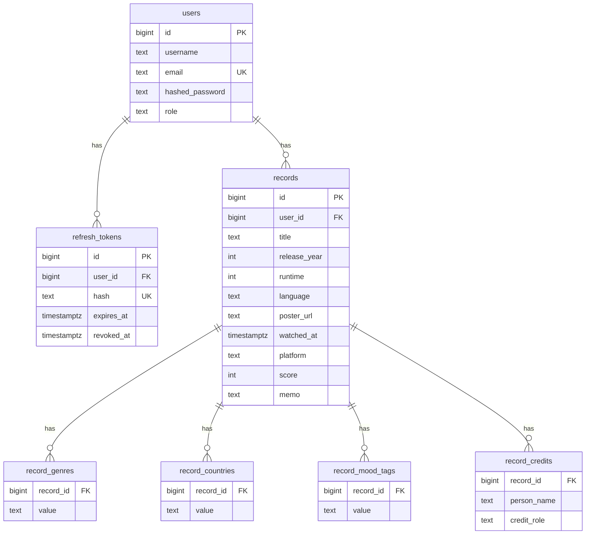

<div align="center">

# Cinelog API

**English** | [日本語](README.ja.md)

The REST API behind Cinelog, a quiet place to log the films you watch.
It keeps your records, looks films up on TMDB and stores your posters.


</div>

This repository is the backend.
It serves the [web app](https://github.com/masaya-nishimura-09/movie-log)
and the [mobile app](https://github.com/masaya-nishimura-09/movie-log-mobile).

## Architecture



The code follows Domain-Driven Design and Clean Architecture.
Every dependency points inward to the domain,
and the infrastructure layer implements the interfaces the domain defines.



## Features

**Records**

- Create, read, update and delete the films you watch
- Search by title, filter by score, platform, mood tags and genres,
  sort and paginate
- Keep genres, countries, credits, mood tags and a memo on each record

**Movies**

- Search TMDB by title and fetch a film's details in the language you ask for

**Media**

- Upload poster images (JPEG, PNG or WebP, up to 5 MB) to S3-compatible storage
- Remove a user's posters when the account is deleted

**Accounts**

- Register, log in and log out
- Short-lived JWT access tokens and refresh tokens that rotate on every refresh
- Refresh tokens are stored as SHA-256 hashes and passwords as bcrypt hashes

**Protection**

- Rate limits per client IP on login, registration and token refresh,
  and per user on uploads
- A 1 MB limit on JSON request bodies
- Client IPs taken only from trusted proxies,
  or from the web app when it sends the shared internal secret

## Tech Stack

| Area      | Tools                                  |
|-----------|----------------------------------------|
| Language  | Go                                     |
| Framework | Gin                                    |
| Database  | PostgreSQL, GORM                       |
| Storage   | Amazon S3 / MinIO (AWS SDK for Go v2)  |
| Auth      | golang-jwt, bcrypt                     |
| Others    | ulule/limiter, godotenv, Docker Compose |

## Getting Started

### Prerequisites

- Go 1.26+
- Docker and Docker Compose
- A [TMDB](https://www.themoviedb.org/) API read access token

### Installation

```bash
git clone https://github.com/masaya-nishimura-09/movie-log-api.git
cd movie-log-api
cp .env.example .env
# Edit .env with your configuration
docker compose up -d postgres minio createbuckets
go run ./cmd/movie-log-api
```

The API listens on `http://localhost:8080`.
The database is created from `scripts/create_tables.sql`
and filled from `scripts/seed.sql` on the first start.

### Seed users

| Email               | Password    |
|---------------------|-------------|
| `test@example.com`  | `Password1` |
| `test2@example.com` | `Password1` |

### Configuration

Set these in `.env`:

| Variable                  | Required | Description                                                          |
|---------------------------|----------|----------------------------------------------------------------------|
| `GIN_MODE`                | No       | `debug`, `release` or `test`                                         |
| `POSTGRES_DSN`            | Yes      | PostgreSQL connection string used by the API                         |
| `POSTGRES_*`              | Yes      | Database settings used by Docker Compose                             |
| `JWT_SECRET`              | Yes      | Secret key for signing access tokens                                 |
| `ACCESS_TOKEN_TTL_HOURS`  | No       | Access token lifetime in hours (default `1`)                         |
| `REFRESH_TOKEN_TTL_HOURS` | No       | Refresh token lifetime in hours (default `720`)                      |
| `AWS_REGION`              | Yes      | Region of the storage                                                |
| `AWS_ACCESS_KEY_ID`       | Yes      | Access key of the storage                                            |
| `AWS_SECRET_ACCESS_KEY`   | Yes      | Secret key of the storage                                            |
| `S3_ENDPOINT`             | No       | Endpoint for S3-compatible storage such as MinIO                     |
| `S3_BUCKET`               | Yes      | Bucket for posters                                                   |
| `S3_PUBLIC_BASE_URL`      | Yes      | Public base URL of the posters                                       |
| `TMDB_ACCESS_TOKEN`       | Yes      | TMDB API read access token                                           |
| `TMDB_ENDPOINT`           | Yes      | Base URL of the TMDB API                                             |
| `TMDB_POSTER_BASE_URL`    | Yes      | Base URL of TMDB poster images                                       |
| `TRUSTED_PROXIES`         | No       | Comma-separated IPs or CIDRs of proxies to trust for the client IP   |
| `INTERNAL_API_SECRET`     | No       | Shared secret the web app sends so its `X-Real-IP` header is used for rate limiting (same value as the web app) |

## Testing

```bash
docker compose up -d postgres-test minio-test createbuckets
go test ./...
```

Tests read `.env.test` and use the test containers
(PostgreSQL on port 5433, MinIO on port 9002).

## Project Structure

```
cmd/movie-log-api/    # Entry point and dependency wiring
internal/
  domain/             # Models, value objects and repository interfaces
  usecase/            # Application logic
  handler/            # HTTP handlers and error responses
  infrastructure/     # PostgreSQL, S3 and TMDB implementations
  middleware/         # JWT auth, body limit and client key for rate limiting
  config/             # Environment variables
  testutil/           # Helpers for tests against the test containers
scripts/              # Table definitions and seed data
```

## API

Send the access token as `Authorization: Bearer <token>` for endpoints marked Auth.
Errors share one shape:

```json
{ "code": "INVALID_INPUT", "message": "per page must be between 1 and 100" }
```

### Authentication

| Method | Endpoint      | Description                         | Rate limit |
|--------|---------------|-------------------------------------|------------|
| POST   | /auth/login   | Log in and get both tokens          | 5 / min    |
| POST   | /auth/logout  | Revoke the refresh token            |            |
| POST   | /auth/refresh | Exchange the refresh token for new tokens | 30 / min |

### Users

| Method | Endpoint        | Description             | Auth | Rate limit |
|--------|-----------------|-------------------------|------|------------|
| POST   | /users/register | Register                | No   | 10 / hour  |
| GET    | /users/         | Get the current user    | Yes  |            |
| PUT    | /users/         | Update the current user | Yes  |            |
| DELETE | /users/         | Delete the current user | Yes  |            |

### Records

| Method | Endpoint     | Description          | Auth |
|--------|--------------|----------------------|------|
| POST   | /records/    | Create a record      | Yes  |
| GET    | /records/    | List your records    | Yes  |
| GET    | /records/:id | Get a record         | Yes  |
| PUT    | /records/:id | Update a record      | Yes  |
| DELETE | /records/:id | Delete a record      | Yes  |

`GET /records/` takes these query parameters, all optional:

| Parameter    | Description                                             | Default      |
|--------------|---------------------------------------------------------|--------------|
| `title`      | Part of the title                                       |              |
| `score`      | Score from 1 to 5                                       |              |
| `platform`   | Platform, such as `netflix` or `theater`                |              |
| `mood_tags`  | Mood tags, repeatable; records must have all of them    |              |
| `genres`     | Genres, repeatable; records must have all of them       |              |
| `sort_field` | `watched_at`, `release_year`, `score` or `title`        | `watched_at` |
| `sort_order` | `asc` or `desc`                                         | `desc`       |
| `page`       | Page number                                             | `1`          |
| `per_page`   | Records per page, from 1 to 100                         | `20`         |

### Movies

| Method | Endpoint       | Description              | Auth |
|--------|----------------|--------------------------|------|
| GET    | /movies/search | Search TMDB by title     | Yes  |
| GET    | /movies/:id    | Get a film from TMDB     | Yes  |

Both take `language` (default `en`); search also takes `title` and `page`.

### Media

| Method | Endpoint | Description         | Auth | Rate limit       |
|--------|----------|---------------------|------|------------------|
| POST   | /media/  | Upload a poster     | Yes  | 30 / hour / user |

## Data Model



## Roadmap

- Elasticsearch for search
- Recommend a movie to watch today
- Recommend movies to others
- Look back on watched movies
- Support for old movies
- Free-form mood tags converted by an LLM

## Credits

This application uses TMDB and the TMDB APIs but is not endorsed,
certified, or otherwise approved by TMDB.
