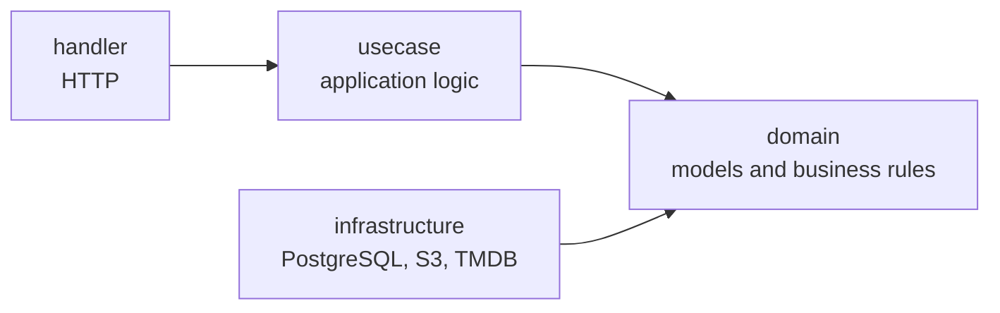
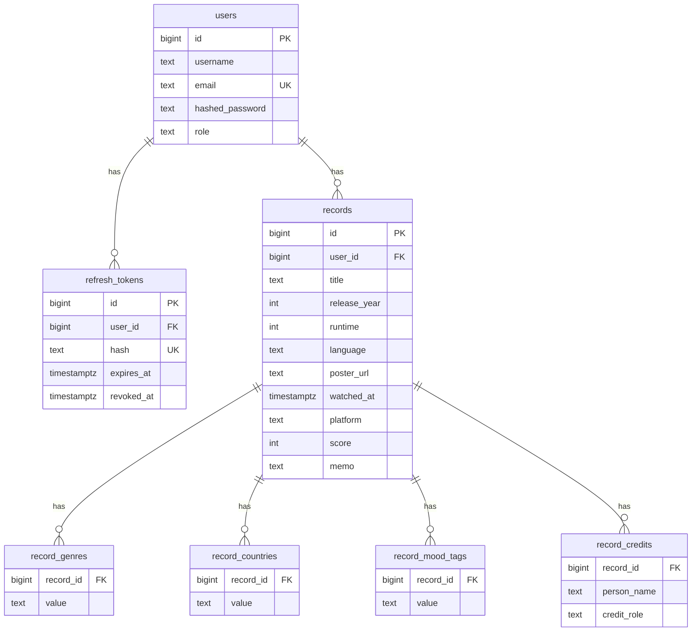

<div align="center">

# Cinestamp API

**English** | [日本語](README.ja.md)

The REST API that powers Cinestamp, an app for keeping a record of the films you watch.<br/>It manages viewing records, searches film information through TMDB, and stores poster images.


</div>

This repository contains the API server used by the
[web app](https://github.com/masaya-nishimura-09/movie-log) and the
[mobile app](https://github.com/masaya-nishimura-09/movie-log-mobile).

## Architecture

### System Overview


### Layers

The codebase is designed according to Domain-Driven Design (DDD) and Clean Architecture.
All dependencies point inward toward the domain layer,
and the infrastructure layer implements the interfaces defined by the domain layer.



## Features

**Viewing records**

- Create, retrieve, update, and delete viewing records
- Title search, filtering by score, platform, mood, and genre, sorting, and pagination
- Genres, countries of origin, credits, moods, and notes for each record

**Film information**

- Title search on TMDB and retrieval of film details in a specified language

**Media**

- Poster image uploads to S3-compatible storage (JPEG, PNG, or WebP, up to 5 MB)
- Deletion of a user's poster images when the account is deleted

**Accounts**

- User registration, login, and logout
- Authentication with short-lived JWT access tokens and refresh tokens that are rotated on every refresh
- Refresh tokens stored as SHA-256 hashes and passwords stored as bcrypt hashes

**Security**

- Rate limiting: per client IP for login, registration, and token refresh;
  per user for film information, poster image uploads, and email and password changes
- A size limit on JSON request bodies (up to 1 MB)
- Client IPs accepted only from trusted proxies and from the web app authenticated with an internal secret

## Tech Stack

| Category  | Technologies                            |
|-----------|-----------------------------------------|
| Language  | Go                                      |
| Framework | Gin                                     |
| Database  | PostgreSQL, GORM                        |
| Storage   | Amazon S3 / MinIO (AWS SDK for Go v2)   |
| Auth      | golang-jwt, bcrypt                      |
| Other     | ulule/limiter, godotenv, Docker Compose |

## Setup

### Prerequisites

- Go 1.26 or later
- Docker and Docker Compose
- A [TMDB](https://www.themoviedb.org/) API read access token

### Installation

```bash
git clone https://github.com/masaya-nishimura-09/movie-log-api.git
cd movie-log-api
cp .env.example .env
# Edit .env and set each environment variable
docker compose up -d postgres minio createbuckets
go run ./cmd/movie-log-api
```

The API starts on `http://localhost:8080`.
When the database starts for the first time, the tables are created by
`scripts/create_tables.sql` and the initial data is loaded from `scripts/seed.sql`.

### Initial Users

The initial data includes the following test users.

| Email               | Password    |
|---------------------|-------------|
| `test@example.com`  | `Password1` |
| `test2@example.com` | `Password1` |

### Environment Variables

Set the following environment variables in `.env`.

| Variable                  | Required | Description                                                          |
|---------------------------|----------|----------------------------------------------------------------------|
| `GIN_MODE`                | Optional | Gin mode (`debug`, `release`, or `test`)                             |
| `POSTGRES_DSN`            | Required | PostgreSQL connection string used by the API                         |
| `POSTGRES_*`              | Required | Database settings used by Docker Compose                             |
| `JWT_SECRET`              | Required | Signing key for access tokens (at least 32 bytes)                    |
| `ACCESS_TOKEN_TTL_HOURS`  | Optional | Access token lifetime in hours (default: `1`)                        |
| `REFRESH_TOKEN_TTL_HOURS` | Optional | Refresh token lifetime in hours (default: `720`)                     |
| `CLEANUP_ENABLE`          | Required | Whether to run the periodic cleanup of expired refresh tokens (`true` or `false`) |
| `CLEANUP_INTERVAL_SECOND` | Required | Interval in seconds between cleanups (at least `1`)                  |
| `AWS_REGION`              | Required | Storage region                                                       |
| `AWS_ACCESS_KEY_ID`       | Required | Storage access key ID                                                |
| `AWS_SECRET_ACCESS_KEY`   | Required | Storage secret access key                                            |
| `S3_ENDPOINT`             | Optional | Endpoint of S3-compatible storage such as MinIO                      |
| `S3_BUCKET`               | Required | Bucket name for poster images                                        |
| `S3_PUBLIC_BASE_URL`      | Required | Public base URL for poster images                                    |
| `TMDB_ACCESS_TOKEN`       | Required | TMDB API read access token                                           |
| `TMDB_ENDPOINT`           | Required | Base URL of the TMDB API                                             |
| `TMDB_POSTER_BASE_URL`    | Required | Base URL of TMDB poster images                                       |
| `TRUSTED_PROXIES`         | Optional | Comma-separated IP addresses or CIDRs of trusted proxies             |
| `APP_VERSION`             | Optional | Version written to logs, such as the Git commit hash                 |
| `INTERNAL_API_SECRET`     | Optional | Secret shared with the web app. When it matches, the `X-Real-IP` header sent by the web app is used for rate limiting (must match the web app's value) |

## Testing

```bash
docker compose up -d postgres-test minio-test createbuckets
go test ./...
```

Tests load `.env.test` and run against the test containers
(PostgreSQL on port 5433, MinIO on port 9002).

## Project Structure

```
cmd/movie-log-api/    # Entry point and dependency wiring
internal/
  domain/             # Models, value objects, and repository interfaces
  usecase/            # Application logic
  handler/            # HTTP handlers and error responses
  infrastructure/     # Integrations with PostgreSQL, S3, and TMDB
  middleware/         # JWT authentication, request body size limit, and rate limit keys
  logging/            # Structured JSON logs for errors and warnings
  config/             # Environment variable loading
  testutil/           # Helpers for tests that use the test containers
scripts/              # Table definitions and initial data
```

## API

For endpoints that require authentication, send the access token in the
`Authorization: Bearer <token>` header. All error responses use the following format.

```json
{ "code": "INVALID_INPUT", "message": "per page must be between 1 and 100" }
```

### Authentication

| Method | Endpoint      | Description                                     | Rate limit |
|--------|---------------|-------------------------------------------------|------------|
| POST   | /auth/login   | Log in (issues an access token and a refresh token) | 5 / min |
| POST   | /auth/logout  | Log out (revokes the refresh token)             |            |
| POST   | /auth/refresh | Reissue tokens with a refresh token             | 30 / min   |

### Users

| Method | Endpoint        | Description                            | Auth     | Rate limit        |
|--------|-----------------|----------------------------------------|----------|-------------------|
| POST   | /users/register | Register a user                        | Not required | 10 / hour     |
| GET    | /users/         | Get the authenticated user             | Required |                   |
| PUT    | /users/username | Update the authenticated user's name   | Required |                   |
| PUT    | /users/email    | Update the authenticated user's email  | Required | 5 / min per user  |
| PUT    | /users/password | Update the authenticated user's password | Required | 5 / min per user |
| DELETE | /users/         | Delete the authenticated user          | Required |                   |

`PUT /users/email` and `PUT /users/password` require the current password.
The rate limit is counted across both endpoints combined.

### Viewing Records

| Method | Endpoint     | Description                | Auth     |
|--------|--------------|----------------------------|----------|
| POST   | /records/    | Create a viewing record    | Required |
| GET    | /records/    | List viewing records       | Required |
| GET    | /records/:id | Get a viewing record       | Required |
| PUT    | /records/:id | Update a viewing record    | Required |
| DELETE | /records/:id | Delete a viewing record    | Required |

`GET /records/` accepts the following query parameters, all of which are optional.

| Parameter    | Description                                                        | Default      |
|--------------|--------------------------------------------------------------------|--------------|
| `title`      | Title (partial match)                                              |              |
| `score`      | Score (1–5)                                                        |              |
| `platform`   | Platform (e.g. `netflix`, `theater`)                               |              |
| `mood_tags`  | Moods (repeatable; returns only records that have all of them)     |              |
| `genres`     | Genres (repeatable; returns only records that have all of them)    |              |
| `sort_field` | Sort key (`watched_at`, `release_year`, `score`, or `title`)       | `watched_at` |
| `sort_order` | Sort order (`asc` or `desc`)                                       | `desc`       |
| `page`       | Page number                                                        | `1`          |
| `per_page`   | Number of records per page (1–100)                                 | `20`         |

### Film Information

| Method | Endpoint       | Description                  | Auth     | Rate limit        |
|--------|----------------|------------------------------|----------|-------------------|
| GET    | /movies/search | Search films on TMDB         | Required | 60 / min per user |
| GET    | /movies/:id    | Get film details from TMDB   | Required | 60 / min per user |

Both endpoints accept `language` (default: `en`). Search also takes `title` and `page`.
The rate limit is counted across both endpoints combined.

### Media

| Method | Endpoint | Description              | Auth     | Rate limit         |
|--------|----------|--------------------------|----------|--------------------|
| POST   | /media/  | Upload a poster image    | Required | 30 / hour per user |

## Data Model



## Roadmap

- Enhanced search with Elasticsearch
- Recommendations for what to watch today
- Recommending films to other users
- Looking back on viewing history
- Support for older films
- Conversion of free-form mood tags with an LLM

## Credits

This application uses TMDB and the TMDB APIs but is not endorsed,
certified, or otherwise approved by TMDB.
